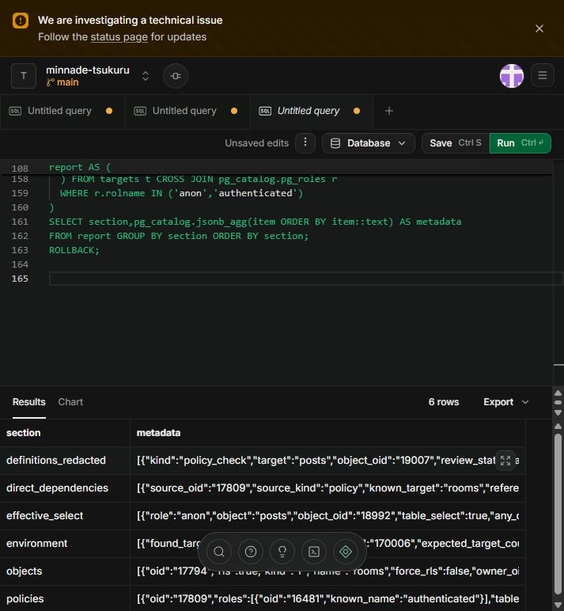

# 実DB・APIセキュリティ調査（2026-10-21）

状態：承認済みSQL実行・コード調査・ローカルモック検証。修正未適用の課題を含む。
P1=早急に閉じる認可/公開境界、P2=機能不整合・競合・防御不足、P3=保守/観測上の改善。
コードで成立する経路、DBメタデータから分かる許可、実環境での攻撃成功は区別する。最後のものは試していない。

## 1. 実環境で確認した事実

承認されたsupabase-policy-view-review.sqlを無変更で実行。入力をファイルと全文照合（BOM/改行差を除く）した。
minnade-tsukuru/main、PostgreSQL 17.6、READ ONLY=on、7対象すべて存在。SQL末尾ROLLBACK、正常終了。
結果：supabase-policy-view-audit-2026-10-21.json。ユーザー行・ビュー結果・アプリRPCは取得/実行していない。

### 権限・ビュー設定
- anon/authenticatedはposts/rooms/room_membersと4ビューすべてにテーブルSELECT=true。
- 3テーブルRLS=true、force_rls=false。所有者OID16384はbypassrls=true、superuser=false。
- 4ビューすべてsecurity_invoker=true、security_barrier=false。所有者がbypassrlsでも、今回のビューを「所有者権限でRLSを迂回する」とは判断しない。前回の未確認事項は解消した。
- ポリシー24件はすべてPERMISSIVE。SELECT/INSERT/UPDATE/DELETEが存在し、ALLは今回対象にない。
- 6件の無条件SELECTは継続して存在する。権限とRLS上の過大許可であり、HTTPでの情報流出実証ではない。

### posts（9ポリシー）
- posts_select_all OID21479：PUBLIC、SELECT、true。
- posts_select_authenticated 19007：authenticated、SELECT、true。
- posts_select 22593：PUBLIC、SELECT。親ルームforced_publishまたは本人membershipのEXISTS。見えている条件にleft_at/非表示/削除条件なし。EXISTS投影値は伏せ字。
- posts_select_visible 24856：authenticated、SELECT。COALESCE(is_hidden,false)=false AND deleted_at IS NULLだけ。参加・公開状態は見ていない。この許可を残すと無条件6件の削除後も非参加者の可視投稿閲覧を許す。
- posts_select_room_members 32955：authenticated、SELECT。本人membershipの存在だけで、退出条件がない。EXISTS投影値は伏せ字。
- posts_update_own 38544：authenticated、UPDATE。USING/WITH CHECKともauth.uid()=user_idだけ。
- posts_delete_own_core_only 32959：authenticated、DELETE。本人投稿かつcore membershipの存在。left_at、親ルームstatus、非表示/削除条件は見えない。creatorは明示されていない。投影値は伏せ字。
- posts_insert_final_core_creator 41961：authenticated、INSERT。本人・final・参加中creator/coreのmembership。親ルームopen/可視/未削除や添付所有権条件がない。投影値と配列区切りは伏せ字。
- posts_insert_log_members 41962：authenticated、INSERT。本人・post_type<>final・参加中membership。親ルーム状態・添付所有権条件がない。投影値は伏せ字。

### rooms（5ポリシー）
- rooms_select_all 21474：PUBLIC、SELECT、true。
- rooms_select_authenticated 17809：authenticated、SELECT、true。
- rooms_insert_own 17810：authenticated、INSERT、created_by=auth.uid()。
- rooms_insert_auth 21475：PUBLIC、INSERT、auth.uid() IS NOT NULLのみ。PERMISSIVEのためinsert_ownの本人制約を強制できない。
- rooms_update_by_creator 19009：authenticated、UPDATE。USING/WITH CHECKともcreated_by=auth.uid()。変更可能列の用途制限はこの式にない。

### room_members（10ポリシー）
- room_members_select_all 21476：PUBLIC、SELECT、true。
- room_members_select_authenticated 18937：authenticated、SELECT、true。
- room_members_select_self 24857、room_members_select_own_v1 32915、room_members_select_own 32953：authenticated、SELECT、user_id=auth.uid()。
- select own membership 38548：PUBLIC、SELECT、user_id=auth.uid()。
- room_members_owner_select 32954：authenticated、SELECT。親rooms.created_byが本人のEXISTS。投影値は伏せ字。
- room_members_insert_supporter_only_v1 32914：authenticated、INSERT、本人 AND role=supporter AND is_core=false。
- room_members_insert_supporter_only 32952：authenticated、INSERT、本人 AND role=supporterのみ。上記is_core=false条件をORで弱める。ただし前回GRANTではauthenticated INSERT=falseなので、この式だけで直接INSERT可能とは言わない。
- room_members_update_last_seen_at 45346：authenticated、UPDATE、USING/WITH CHECKとも本人 AND left_at IS NULL。名前にかかわらず列制限はRLSの仕事ではない。

### 4ビューの定義・依存
完全な伏せ字済み定義は証跡JSONと別紙SUPABASE_POLICY_VIEW_DETAILS.mdに記録。
- rooms_with_counts_v2：roomsの複数列を投影。各部屋についてleft_at IS NULLのDISTINCT user_id数をmember_countとし、creator/coreの人数も集計。外側WHEREによるhidden/deleted除外なし。基底RLSとクライアントのフィルターに依存する。直接依存はrooms/room_members。
- rooms_with_counts：rooms LEFT JOIN room_members、rooms.deleted_at IS NULL。is_hidden除外なし。member_countにleft_at条件なし・DISTINCTなし。直接依存はrooms/room_members。v2と人数定義が違う。
- profiles_public：profilesからid/usernameと追加6列を投影。WHEREなし。今回の依存列番号を前回カタログと照合するとx_url/youtube_url/instagram_url/tiktok_url/website_url/bio。公開行の境界はprofilesのRLS次第（今回対象外）。
- report_counts：対象種別・IDでcount(*)の集計。元テーブル名等は伏せ字。直接依存OIDを前回カタログと照合するとreportsのtarget_type/target_id。reportsのRLS次第（今回対象外）。
- pg_rewrite内部依存として各ビュー自身も記録される。これは再帰参照の証拠ではない。推移的依存や関数内部の動的SQLは未確認。
- 以前のカタログとのOID/列番号照合は同日スナップショット間の照合。DDLが並行変更された可能性までは排除していない。

### 既読との互換性
今回の本人UPDATEポリシーに対して、前回同日監査のauthenticated.last_seen_at UPDATEはfalse。GRANTがないためブラウザー直UPDATEは通らない構成。今回SQLはUPDATE権限を再取得していない。
MarkRoomSeenOnView.tsxは直接UPDATEのerror結果を処理しない。一方、/api/rooms/seenはBearer本人確認＋参加中本人行をService Roleで更新し、BoardClient/作品側から使われる。全既読機能が停止しているとは言わない。
/api/rooms/mark-readは実DBに存在しないlast_read_atを参照する旧経路。対応はseenへ統合する案。全列UPDATE付与で解決しない。

## 2. 重要な不一致・優先度

### P1-01：閲覧境界がDBで強制されない（DB確認済み）
6件のtrueと追加のposts_select_visible等。APIは非表示/削除投稿、非表示/削除ルーム、公開状態を確認しているがDB SELECTはその境界を強制しない。
rooms.core_invite_codeも全列SELECT対象。専用APIがcreator限定でも基底テーブル許可が広い。実値は取得していない。
対応：RLS_SELECT_REMEDIATION_PLAN.mdの全許可見直し＋公開列制限。ビューは既にinvokerのため、本人membershipへ絞ると人数が本人分に縮む対策を同時設計する。

### P1-02：直接DMLがAPI制約を迂回できるRLS条件（設定確認、実動作未検証）
前回GRANTでauthenticatedはposts/roomsのINSERT/UPDATE/DELETE可。今回posts_update_ownは本人条件だけで、post_type/attachment_url/room_id/is_hidden等の列UPDATEが前回すべてtrue。
APIでsupporterのfinal作成、公開後投稿、他ルームpath等を拒否しても、DBポリシーは同じ制約を保証しない。rooms_insert_authもcreated_by本人を保証しない。
CHECK/Trigger/RPC本文は未レビューのため、すべての不正書き込みが実際に成功するとまでは断定しない。添付台帳をAPIだけに導入しても、この迂回口を閉じなければ所有権は保証されない。

### P1-03：認証不要の状態更新（コード・モック確認）
POST /api/rooms/expireは認証なしでService Roleによるopen→forced_publish更新を行う（expires_at<=nowに限定）。任意ルーム・任意時刻を自由に指定できるわけではないが、cron認証を通らず全対象の公開処理を起動できる。
middlewareはauth.getUser後に常にnextを返し、アクセス拒否しない。外部ゲート/実デプロイは未確認。モックで匿名リクエストが更新へ到達することを確認。
対応：公開APIの廃止または認証済みジョブへ統合。今回は認証設計変更に当たるため実装しない。

### P1-04：旧参加APIによる同意・枠・退出ロック迂回（コード・モック確認）
POST /api/rooms/join と POST /rooms/join はBearer本人確認後、可視openルームへsupporterをupsert。同意・人数・既存roleを確認せず、既存core/creatorもsupporterに上書きし、is_coreは旧値を残す。
モックでcoreがsupporterへ変わり、その後leaveの5分制限を迂回する経路を確認。creatorにも降格可能なコードだが、DBトリガーとの組合せは未検証。
旧APIの入力にrole=creatorを指定して他人を昇格する経路はない（userIdは認証結果、roleは固定）。問題は降格/制限回避と整合性破壊。
JoinButton→/api/rooms/joinの参照は残るが、現行親画面はcanPostのときだけBoardClientを描画し、旧ボタン条件は!isMember。通常表示の到達性は低い。UIから消えてもHTTPルートは残る。

### P1-05：添付所有権未照合（モック確認）
posts/createは同じroomのpath形式だけ確認し、所有者・存在・再使用を確認しない。同一room他ユーザーpathがHTTP200になる既知GAPを再確認。推測でownerを決めて旧データを台帳登録してはならない。
対策前提はATTACHMENT_UPLOADS_READINESS.md。

### P1-06：旧core承認・is_core経路（コード確認、実DB成功は未検証）
/rooms/[id]/core-approveはcreator本人照合をするが、枠・ルーム状態・同意を確認せず、申請更新とcore INSERTが別処理。モックで人数100のfixtureでもINSERTへ進む。
/api/rooms/expire/joinはis_core人数<5で自動is_core=true、roleを明示せず、招待/承認/同意/非表示・削除を確認しない。新UIはroleを使うためis_core=trueだけで現行core権限を得たとは断定しない。実DBのNOT NULL/default/TriggerによってINSERT可否も変わる。
削除/統合候補。RPCの直接EXECUTE権限（前回6関数anon/auth可）と内部認可もUSER APPROVAL REQUIREDでレビューする。

### P2
- P2-01 GET /api/debug/buckets：未認証でService RoleのlistBuckets、プロジェクトURL・bucket id/name/public・エラーを返す。モックで到達確認。キー値は返さない。不要な情報開示として削除/本番無効化候補。
- P2-02 join-supporter/request-core：open確認のみでhidden/deletedを見ない。supporterはcount→upsertが非原子的で45枠の競合を防げない。モックで非表示・削除済みopenにもupsertへ到達。DBトリガーの追加拒否は未確認。
- P2-03 join-core-first-come/by-invite/approve-core：RPC完了後に同意列UPDATE、失敗時に参加/承認だけ残り得る。APIの同意値は空でない文字列チェックだけで版・日時のサーバー検証なし。
- P2-04 /api/posts/delete：本人・open・membership存在を確認するがleft_at条件がない。退出済み本人の削除到達をモック確認。コメント・他APIの参加中要件と不一致。
- P2-05 既読の直接UPDATE権限不一致、last_read_atの旧経路、account/deleteのprofiles.user_id/display_name/avatar_url不存在。account deletion仕様は未変更。
- P2-06 OwnerCoreRequestsPanelは/api/rooms/{id}/core-*を呼ぶが実ルートは/rooms/{id}/core-*。core-requestsも同様。next.configにrewriteなし。現行RoomDetailClientは別の正しい/api/rooms/approve-core等を使うため、全承認機能停止ではない。
- P2-07 /api/rooms/unread-mapは非表示/削除投稿を除外しないがlib/rooms/getUnreadMapForUserは除外する。いずれもルーム可視性を別確認しない。本文は返さないが件数と画面に不一致。
- P2-08 ルーム作成とcreator membership作成、物理room削除とmembership削除、プロフィール複数表同期が非原子的。削除APIはroom_members削除エラーを見ない。添付台帳導入時は削除とcleanupの整合が必須。
- P2-09 cronはURL queryのsecretを比較。値は取得していない。URLログ等に残る方式なのでヘッダー認証へ移行提案。認証変更は未実施。
- P2-10 toggle-markはactive core/creatorと投稿room一致は確認するが、親ルーム公開/非表示/削除、投稿is_hiddenは確認しない。公開後の編集可否を仕様と合わせる。
- P2-11 /rooms/[id]/core-requestはuser client INSERTを試みるが、前回room_join_requests INSERT=false。旧経路は同意も不要で、GRANTだけ開くと制約不足になる。

### P3
- DBエラー本文やcronの環境有無debugを返す箇所を標準化する。今回秘密値を検出/取得したという意味ではない。
- adminヘルパーが2系統、ルートごとに認証・同意処理が重複。server-only import境界を明示する余地がある。現時点でclientへのService Role値の流出を確認したわけではない。
- legacy is_coreとrole、username長2–20と旧updateの1–24など不一致を整理する。
- AttachmentViewのimg警告、Next middleware命名非推奨は別の保守対応。

## 3. 参加・権限関連APIの全経路

リポジトリ内route.tsと呼び出し文字列を照合。外部クライアントの使用状況は不明。APIは実際に呼んでいない。
- /api/rooms/create：現行作成UI。creator生成。認証UID固定だがroom作成とmembershipは別処理。
- /api/rooms/join-supporter：現行RoomDetailClient。supporter固定、同意必須、45枠の事前count。P2-02/03。
- /api/rooms/join-core-first-come：現行UI。認証UIDをRPCへ渡す。承認設定/枠/roleはRPC依存、本文未確認。
- /api/rooms/join-core-by-invite：現行UI。code・同意必須、認証UIDをRPCへ。招待照合/枠はRPC依存。
- /api/rooms/request-core：現行UI。open/approval ON、pending重複確認、core同意。状態・競合課題あり。
- /api/rooms/approve-core、reject-core：現行UI。認証UIDをcreator引数としてRPCへ。creator認可そのものはRPC依存。approveの同意コピーは別UPDATE。
- /api/rooms/leave：現行UI。creator拒否、core5分制限、active本人。旧joinで制限迂回可能。
- /api/rooms/[id]/invite-code：現行InviteCodeForCreator。認証UIDとcreated_by一致。基底roomsのSELECT過大許可が別経路になる。
- /api/rooms/join：旧JoinButtonから参照、通常UI到達は前述の条件で抑制。P1-04、統合/廃止候補。
- /rooms/join：参照呼び出し未検出の重複旧API。P1-04、廃止候補。
- /api/rooms/expire/join：参照呼び出し未検出。is_coreベース旧API、P1-06。profiles.user_idの旧列参照もある。
- /rooms/[id]/core-request：参照呼び出し未検出。Cookie本人＋user client。INSERT権限不一致、同意/状態検査なし。
- /rooms/[id]/core-requests：Cookie本人＋created_by一致後user clientで申請一覧。OwnerCoreRequestsPanelの呼び先パス不一致。
- /rooms/[id]/core-approve、core-reject、core-revoke：Cookie本人＋created_by、申請room一致を確認。UIのパス不一致。approve枠不足、revokeはactive/locked coreを物理削除し得る。更新とmembership操作が非原子的。新RPC系へ統合候補。
- /api/notifications/pending-core-count：Cookie本人＋所有ルーム一覧から申請count。Service Role不使用。読み取りRLS変更時に回帰確認。
- /api/rooms/delete：Bearer本人＋created_by/host_ids/旧host roleのOR認可。退出済み旧hostを除外しない。role体系移行と削除方針のレビューが必要。

現行APIへ統合する場合でも、単に旧APIを新APIへforwardすると同意不足や旧引数を許すおそれがある。旧書き込み経路は明示的に閉じ、新しい入力・原子的認可を必須にする。

## 4. Service Role利用箇所の評価

一覧のパスはapp/を基準（libは明記）。全体の機械抽出一覧はSUPABASE_POLICY_VIEW_DETAILS.md末尾。API以外のroute.tsも確認した。
- api/uploads、api/uploads/sign、api/storage/sign：非公開Storageの書き込み/署名に使用。認証と参加中照合、または公開作品・可視投稿照合が先行。pathはDB保存値またはサーバー生成。署名のService Roleは限定用途なら維持可能。通常clientへの単純置換はStorage Policyレビューが必要。
- api/uploads/public/[postId]：storage/signを再利用する間接利用。公開境界を同じ処理で確認。
- api/posts/create：認証、visible open room、active member、final roleを確認。client path所有権が未検証。通常client+RLSへの代替にはP1-02解消と原子的台帳処理が必要。
- api/posts/delete、toggle-mark：各本人/role認可あり。P2-04/10。列限定RPC/RLSで代替可能だが現ポリシーでは不十分。
- api/rooms/create、delete：複数表操作・creator/host認可。通常client単純置換より、検証済み原子的RPCへの集約を推奨。P2-08。
- api/rooms/join、rooms/join、api/rooms/expire/join：不要な旧権限経路。安全なRLS置換以前に廃止/統合優先。
- api/rooms/join-supporter、request-core：本人認証後にadmin操作。hidden/deleted/競合課題。本人clientでも最終権限はDBで保証する設計が必要。
- api/rooms/join-core-first-come、join-core-by-invite、approve-core、reject-core：本人由来IDをRPCへ。APIの認証はあるがDB内認可は未確認。API専用ならRPC EXECUTEをservice_roleへ限定する案。
- rooms/[id]/core-approve、core-reject、core-revoke：Cookie本人・所有者・対象room確認。旧経路を統合優先。creatorが他人のmembershipを変更するため本人RLSだけでは代替できない。
- api/rooms/[id]/invite-code：creator認証後の秘密列取得。狭いAPIとして維持可能。通常clientへ返すためにrooms全列公開しない。
- api/rooms/seen、mark-read：本人行更新。seenはactive確認。column UPDATEと本人RLSでも代替可能だが、現時点は権限なし。旧mark-readは廃止候補。
- api/rooms/unread-map、lib/rooms/getUnreadMapForUser.ts：認証後本人active membershipsから集計。適切なSELECT RLSなら通常clientへ代替可能。公開境界を揃える。
- api/rooms/like：本人UID固定。room可視性確認なし、削除エラー未確認。本人likes RLSで代替候補。
- api/reports/create：本人reporter固定、種別/理由確認。user client+INSERT RLSで代替候補。対象の存在・閲覧可否、濫用制限は別確認。
- profile/set-username、set-bio、set-sns-links、api/update：本人UID固定、許可したプロフィール項目だけ。複数表同期/他テーブルの表示名更新にadmin使用。本人RLSで基本更新、整合した同期処理で代替可能。api/updateは旧バリデーション不一致で統合候補。
- api/account/delete：本人認証後Auth管理API。Auth削除には管理権限が必要。列不一致・FK・保持方針を先に修正設計。今回仕様変更しない。
- api/cron/publish：サーバージョブとしてadmin必要。secret必須だがURL方式。api/rooms/expireは未認証で同等更新しP1。
- api/debug/buckets：未認証、不要な管理メタデータ取得。P2、削除候補。
- rooms/[id]/page.tsx：匿名でもroom詳細をadmin取得後hidden/deletedを除外。公開列の通常client+RLSで代替候補。不要な招待コード取得を減らす。
- api/rooms/_shared.ts：admin本人認証/fetchRoomヘルパー。参照箇所を検索して統合時に利用有無を再確認。fetchRoom自体は認可を行わない。
- lib/supabase/admin.ts、lib/supabase/server.ts：admin生成元。単なる生成元なので認可の責任は呼び出し側。

client入力userId/ownerIdを本人と信じる主要ルートは今回の読解では確認していない。一方、role変更・capacity・room状態・path所有者を確認しない経路は上記のとおり。Service RoleはRLSを通らないためAPI側チェックだけでなくDB直アクセスも合わせて閉じる必要がある。

## 5. 承認待ちと次の作業
USER APPROVAL REQUIRED：
1. 既存RPC/Trigger/CHECKの安全な本文レビューとStorage Policyの追加読み取り監査。今回承認は1本のSQLのみのため追加実行していない。
2. 旧join/expire/debug/旧core経路の停止・統合方針（認証/API設計変更）。
3. SELECTと直接DMLの権限制限、参加人数API、招待コード列保護の具体的DDLと適用。
4. attachment_uploadsの保持期間・owner/room削除・旧作品保持方針を確定し、ステージング実装へ進む判断。
5. 本番ユーザー行を用いた調査や本番変更は今回範囲外。モック結果だけでDB競合・RLS・Triggerを検証済みとしない。

テスト結果・変更ファイルの確定値はAI_HANDOFF.md第24節以降に記録する。

### 監査実行画面

### 補足：管理用ローカルスクリプト

- scripts/reset-password.mjsもService Roleを使用する。文字列・数値リテラルを伏せたAST出力で構造だけを確認し、実行していない。
- 操作者が渡したuserIdと新パスワードでAuth admin.updateUserByIdを実行するCLI。HTTP APIではなく、管理権限を持つローカル操作者用。通常authenticated clientで任意他人のパスワード更新へ代替してはならない。
- 新パスワードをコマンドライン引数に渡す設計は履歴・プロセス一覧への露出リスクがある（P2）。対話入力等への改善を提案するが今回は認証/資格情報操作を行わない。

## 追加作業による状態更新（2026-10-21）

本書は当初の監査証跡として保持する。最新のローカル修正状態はLOCAL_SECURITY_HARDENING_2026-10-21.mdとAI_HANDOFF第27節以降を参照。
P1-03、P2-01、P2-04はローカル修正済み。P1-04の/rooms/joinとP1-06のexpire/joinを停止したが他経路は残る。P2-02の可視性漏れは修正、人数競合は残る。デプロイ/DB権限修正はしていない。

## 旧API整理の追加更新（2026-10-21）

今回ユーザー承認により/api/rooms/joinと/rooms/[id]/core-request・core-approve・core-reject・core-revokeをローカル410化。JoinButton/OwnerCoreRequestsPanelを除去し現行RoomDetailClientにUIを一本化した。本文の「旧join/旧coreは保持・未解決」はこの変更前の状態を示す。最新詳細はLEGACY_JOIN_CORE_RETIREMENT.mdとAI_HANDOFF第29節。DB直接DML/RPC/添付所有権は未修正、本番未適用。
## Web MVP修正追記（2026-10-21）

添付の同一room他人pathはAPIで拒否し、新台帳/RPCをローカル実装（実DB未適用）。メール由来fallback名を20文字以内のランダム名へ。cronのBearer認証/非表示・削除除外とrate limit案、未読のNULL混在/非表示・削除/親room判定を修正。
現在の残るP1/P2はWEB_MVP_IMPLEMENTATION.mdが正本。本番のRLS/GRANT/旧RPC/Storage問題、退会・既存個人情報の扱いは解決していない。旧監査本文の発見は証跡として保持する。
